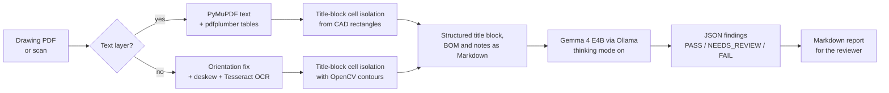

# Drawing Verification AI

**Offline checking of engineering drawings and their documents, using a locally run Gemma 4 E4B model.**

Drawing review is slow, repetitive and easy to get wrong: a misspelled title, a BOM line that names a part number with no drawing behind it, a `NEXT ASSY.` link that the parent assembly never lists, or a tolerance copied into the inspection checklist from the wrong row. This repository holds three tools that automate those first-pass checks, so a reviewer starts from a list of suspected problems instead of a blank sheet.

Everything runs on the engineer's own machine through [Ollama](https://ollama.com). No drawing, BOM or checklist leaves the computer.

| Tool | Engineering problem | What it produces | Status |
| :--- | :--- | :--- | :--- |
| **[drawing-audit](drawing-audit/)** | One drawing: typos, contradictions in the title block, title block vs BOM mismatches | Markdown report with severity-ranked findings, extracted title block and BOM, and the model's reasoning trace | Complete pipeline |
| **[dimcheck](dimcheck/)** | Filling the Tolerance column of a dimension inspection checklist by hand | Filled checklist `.docx` plus a per-row CSV saying where each tolerance came from and how confident the match is | Complete pipeline |
| **[coherence](coherence/)** | A set of drawings and documents for one product that disagree with each other | Cross-file report: revision, date and title conflicts, missing BOM drawings, broken `NEXT ASSY.` links | Complete script |

## Key design decision: the model reads text, not pictures

Small vision models misread the dense, tiny text of a title block or BOM table. So the drawing-audit pipeline never asks Gemma to look at the drawing. Deterministic code extracts and structures the content first, and the model only reasons over clean text.



- **OCR only as a fallback.** Vector PDFs exported from CAD are read exactly from their embedded text; OCR runs only on scanned pages, after Tesseract's orientation detection rotates sideways or upside-down sheets upright.
- **One field per box.** Title blocks are usually drawn as bordered cells. The pipeline reads the CAD file's own rectangle entities (or detects the boxes with OpenCV on a scan), reads each cell separately, and pairs label-only boxes with the adjacent value box. Regex over the whole corner fills any gaps.
- **Conservative reporting.** The audit prompt asks only for confident findings, treats missing fields as low severity, and reports garbled OCR as an `ocr_quality` finding rather than guessing a fix. Unparseable model output becomes a `NEEDS_REVIEW` result, never a silent pass.
- **Rules decide, the model extracts.** In the coherence checker the model only pulls fields out of each file; every mismatch is raised by plain Python rules that can be read and tested.
- **Traceable output.** dimcheck labels every tolerance as `explicit`, `general_table`, `assumed` or `unresolved` with a confidence level, and leaves a cell blank rather than guess.

## Example

[`examples/synthetic_drawing.pdf`](examples/synthetic_drawing.pdf) is a small synthetic drawing with a deliberate typo ("MOUNTING BRAKCET"), a zero-quantity BOM line, and a note citing "REV A" of a spec on a drawing at revision B. [`examples/synthetic_structured_input.md`](examples/synthetic_structured_input.md) is the real output of the extraction and structuring stages for it: the exact text the model receives, with all five title-block fields read from their own boxes and the BOM read from the ruled table.

## Quick start

```bash
ollama pull gemma4:e4b
cd drawing-audit
pip install -r requirements.txt
python main.py path/to/drawing.pdf --json
```

Windows setup, Tesseract installation and template tuning are covered in [drawing-audit/README.md](drawing-audit/README.md).

## Validation

| What | How it was checked |
| :--- | :--- |
| Extraction, cell isolation, BOM parsing, report structuring | `tests/test_drawing_audit.py` on the synthetic vector PDF |
| Audit stage JSON handling and fallback | Same file, with a stub client in place of Ollama |
| Zone grid detection, general-tolerance parsing, dimension matching, full checklist fill | `tests/test_dimcheck.py` on the synthetic PDF and a hand-built checklist `.docx` |
| Cross-drawing and cross-document rules | `tests/test_coherence.py` with hand-built records |

```bash
pip install -r drawing-audit/requirements.txt python-docx openpyxl requests pytest
python -m pytest
```

The tests do not call a model, so they verify the deterministic stages, not Gemma's judgement. The dimcheck result in its README (six of six tolerances reproduced on a real drawing and checklist pair) comes from the original development run; that drawing is not published here.

Writing these tests found one bug in the general-tolerance parser: `ANGLE ±1/2°` was read as `±1`. It is fixed in this repository.

## Limitations

- These are first-pass review aids, not certified inspection tools. Every finding needs an engineer's confirmation.
- Title-block and BOM extraction is heuristic and tuned through `drawing-audit/config.py`; unusual templates may need new label aliases or region settings.
- Gemma 4 E4B is a small on-device model and can miss subtle errors or raise false positives. CPU-only runs with thinking mode are slow.
- Notes extraction is simple and can carry list numbering or neighbouring text into a note.
- dimcheck's asymmetric/unilateral stacked-figure tolerances (two numbers above/below the dimension line, rather than an inline `±` value) are a known open issue: they currently fall through to the general tolerance table instead of being read as an explicit value.
- The coherence checker reads PDF text only and skips scanned sheets.

## Repository layout

```
drawing-audit/   single-drawing audit pipeline (Gemma 4 E4B, Ollama, PyMuPDF, OpenCV, Tesseract)
dimcheck/        drawing tolerances -> inspection checklist .docx
coherence/       cross-file consistency checks for a drawing and document set
examples/        synthetic drawing and its structured model input
tests/           pytest suite for the deterministic stages
```

See [NOTICE.md](NOTICE.md) for rights and attribution.
