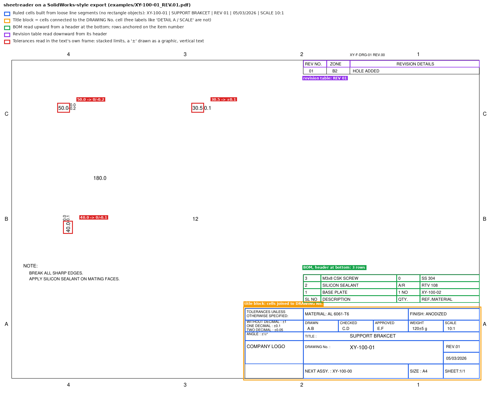
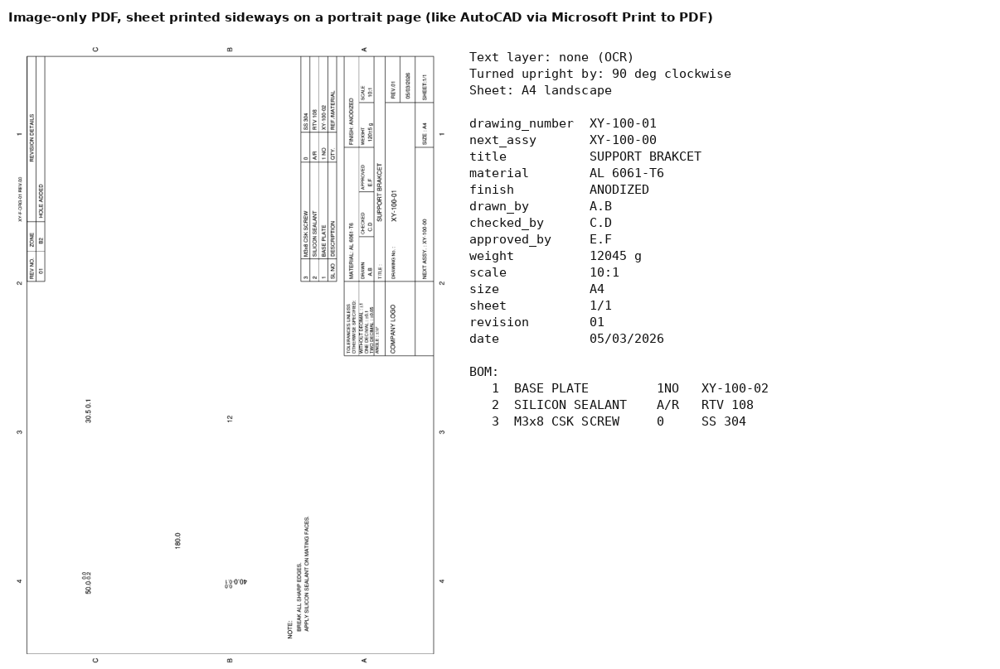
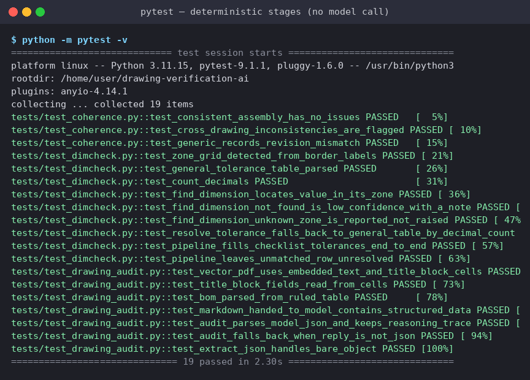
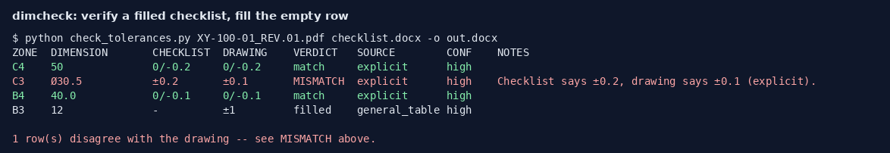

# Drawing Verification AI

> **New: Drawing QC agent** - checks the literal parts of a whole drawing set (title block, BOM, notes,
> references, balloons, checklists) before print, with a local model for judgement calls.
> See [QC_AGENT.md](QC_AGENT.md): `python -m qc doctor`, then `python -m qc review <folder>`.

> **Supervisor Edition — experimental v0.1.0.** This branch is a separate edition.
> Start with [SUPERVISOR_EDITION.md](SUPERVISOR_EDITION.md) for installation and the new CLI.
> The existing readers and checks remain unchanged from commit `1255b86`.
> Gemma supervises evidence review through bounded tools. Live Gemma accuracy has not yet been validated.
> The baseline documentation below describes the original tools, which remain available.

**Offline checking of engineering drawings and their inspection documents, with a locally run Gemma 4 E4B model.**

Drawing review is slow, repetitive and easy to get wrong. Typical slips are a title-block scale that can't be right, a BOM line naming a drawing that isn't in the set, a `NEXT ASSY.` the parent never lists, or a checklist tolerance copied from the wrong row. This repository automates those first-pass checks, so a reviewer starts from a short list of suspected problems instead of a blank sheet.

Everything runs on the engineer's own machine. No drawing, BOM or checklist leaves the computer.

| Tool | Engineering problem | What it produces |
| :--- | :--- | :--- |
| **[drawing-audit](drawing-audit/)** | One drawing, or a folder of them: title block, revision table, BOM, scale, spelling | Markdown report per sheet: findings by severity, plus everything that was read |
| **[dimcheck](dimcheck/)** | The Tolerance column of a dimension inspection checklist | Fills empty rows from the drawing and **verifies** filled ones (match / MISMATCH), with a per-row CSV |
| **[coherence](coherence/)** | A drawing set and its checklists that disagree with each other | Cross-file report: BOM vs child drawings, `NEXT ASSY.` links, checklist vs drawing, template tolerances |

All three share one reader, **[sheetreader](sheetreader/)**, which turns any drawing PDF into structured data.

## Works on the PDFs CAD tools actually produce

The tools were rebuilt against real company drawings: two SolidWorks exports and three AutoCAD sheets plotted through *Microsoft Print to PDF*. They are confidential, so they are not in this repository. Those files showed that the obvious approach (look for rectangle objects, regex the text) fails on every one of them:

| What the real files do | How sheetreader handles it |
| :--- | :--- |
| Title blocks and BOMs are drawn from **loose line segments**, never rectangle objects | Each word is placed in the box its surrounding ruling lines enclose; words with the same box form a cell |
| AutoCAD Print-to-PDF has **no text layer at all**: every letter is drawn as line strokes | Rasterise and OCR, after erasing ruling lines; each title-block and table cell is then re-read on its own |
| The landscape sheet is **printed sideways** onto a portrait page | Try each rotation and keep the one where title-block labels actually read (Tesseract's own orientation guess scored 0.01 confidence on these) |
| BOM header at the **bottom**, items numbered upward; one item spanning sub-rows | Rows are read outward from the header, in either direction, and anchored on the item-number cell |
| **Vertical dimensions** came back reversed (`20.5` → `5.02`) | Every word keeps its reading direction; tolerances are found in the text's own frame |
| `±` and `Ø` drawn as **graphics**; stacked limits (`0.0` over `-0.2`) as separate words | Tolerances read by position: a bare small figure after a dimension is ±, two figures one over the other are upper/lower limits |
| OCR look-alikes (`AI-` for `AT-`, `±` read as `#`, `=` or `2`) | Identifiers from OCR are compared allowing look-alike characters; general tolerances pick the reading that is plausible for its tier |



The same sheet as an image-only PDF, printed sideways like an AutoCAD plot, is read to the same title block and BOM:



## Rules decide, the model proofreads

At about 7 tokens/s on a typical office PC, asking Gemma to reason over a whole drawing with thinking on takes several minutes per sheet. Most of what it was asked to notice is mechanical anyway, so it is now done by plain, tested Python rules:

- **Title block:** every field present; the drawing number and revision match the file name; DRAWN is not also APPROVED.
- **Revisions and sheet:** the title-block revision matches the latest revision-table entry; SIZE matches the real sheet size; the date is valid and not in the future.
- **Scale:** the title-block scale can fit the largest dimension on the sheet.
- **BOM:** no duplicate or skipped item numbers; no zero or blank quantities.

Spelling uses three layers. A list of known engineering misspellings comes first (ANEROBIC → ANAEROBIC, SILICON sealant → SILICONE). An offline dictionary with an allow-list of shop terms comes next. Only then does **one short Gemma call with thinking off** see just the text lines. A phrase the model reports must actually appear on the drawing, so it can't invent a finding. The original full reasoning audit is still available as `--deep`.

On the five real drawings these rules raised:

- a title-block **SCALE 10:1** on a 508 mm part on A3 (it would be 5 m long on paper; the section view on the same sheet says 1:4);
- **ANEROBIC** and **SILICON SEALANT** in a BOM;
- drawings on the **same template form** with different general tolerances (ONE DECIMAL ±0.5 vs ±0.1).

## Validation

| What | Result |
| :--- | :--- |
| dimcheck on a real drawing + inspection checklist (20 dimension rows: six stacked limits, nine printed `±` values, five from the general table) | **20 / 20** correct, both filling a blanked checklist and verifying the original `.doc`. Before the rebuild: 8 / 20, with 2 silently wrong |
| Title block, BOM and revision table on the five real drawings | All fields and every BOM row read correctly, checked by eye against each sheet. BOM items: 11 / 11, 6 / 6, 5 / 5 |
| Public test suite (synthetic drawings only, no model) | 37 tests: reader, rules, language layers, dimcheck fill/verify, cross-file rules, and the sideways image-only scan through OCR |

```bash
pip install -r requirements.txt pytest
python -m pytest
```



The real-drawing results come from `tests/test_real_samples.py`. It runs only when `DVA_SAMPLES_DIR` points at a local folder holding the drawings and an `expected.json`, so the confidential files never enter the repository.

The tests don't call a model, so they verify the deterministic stages, not Gemma's judgement.

## Example

[`examples/XY-100-01_REV.01.pdf`](examples/XY-100-01_REV.01.pdf) is a synthetic drawing built like a SolidWorks export. [`examples/XY-100-01_REV.01_sideways_scan.pdf`](examples/XY-100-01_REV.01_sideways_scan.pdf) is the same sheet as a sideways, image-only plot. Both produce the same findings: [text-layer report](examples/XY-100-01_REV.01_report.md), [scan report](examples/XY-100-01_REV.01_sideways_scan_report.md).

dimcheck verifying a filled checklist against it, with one planted wrong value:



## Quick start (Windows)

1. Install [Python 3.10+](https://www.python.org/downloads/) (tick **Add python.exe to PATH**), [Ollama](https://ollama.com/download), and [Tesseract](https://github.com/UB-Mannheim/tesseract/wiki). Tesseract is needed only for sheets without a text layer.
2. In PowerShell, in this folder:

```powershell
python -m venv venv
venv\Scripts\activate
pip install -r requirements.txt
ollama pull gemma4:e4b

python drawing-audit\main.py path\to\drawings            # every PDF in the folder
python dimcheck\check_tolerances.py DRAWING.pdf CHECKLIST.doc -o CHECKED.docx --report review.csv
python coherence\check_coherence.py path\to\drawing_set --out coherence_report.md
```

`drawing-audit` and `coherence` also work with no model at all (`--no-model`). Then only the rules, known misspellings and dictionary run.

## Limitations

- These are first-pass review aids, not certified inspection tools. Every finding needs an engineer's confirmation.
- OCR'd sheets (no text layer) are read well but not perfectly: a weight like `120±5 g` can come back as `12045 g`. Values read by OCR are labelled as such in every report. Exporting PDFs from CAD with text kept as text (TrueType rather than SHX fonts) makes every check exact and takes a sheet from about 20 s to under 1 s.
- Title-block wording outside the built-in label list needs adding to `drawing-audit/config.py` (`EXTRA_TITLE_BLOCK_LABELS`).
- The scale check uses the largest dimension value on the sheet; a view drawn at a different scale from the title block can make it pass when it shouldn't, never the reverse.
- Gemma 4 E4B is a small on-device model; its spelling suggestions are labelled `(model)` in the report.

## Repository layout

```
sheetreader/     shared reader: text layer or OCR -> words, ruling lines, cells, title block, tables
drawing-audit/   per-drawing rules, language check (Gemma 4 E4B via Ollama), report
dimcheck/        drawing tolerances -> inspection checklist (.docx / .doc), fill and verify
coherence/       cross-file checks for a drawing set and its checklists
examples/        synthetic drawing, its sideways scan, and their reports
tests/           pytest suite; synthetic drawing generators; local-only real-drawing tests
assets/          README figures, written by tests/make_figures.py
```

See [NOTICE.md](NOTICE.md) for rights and attribution.
