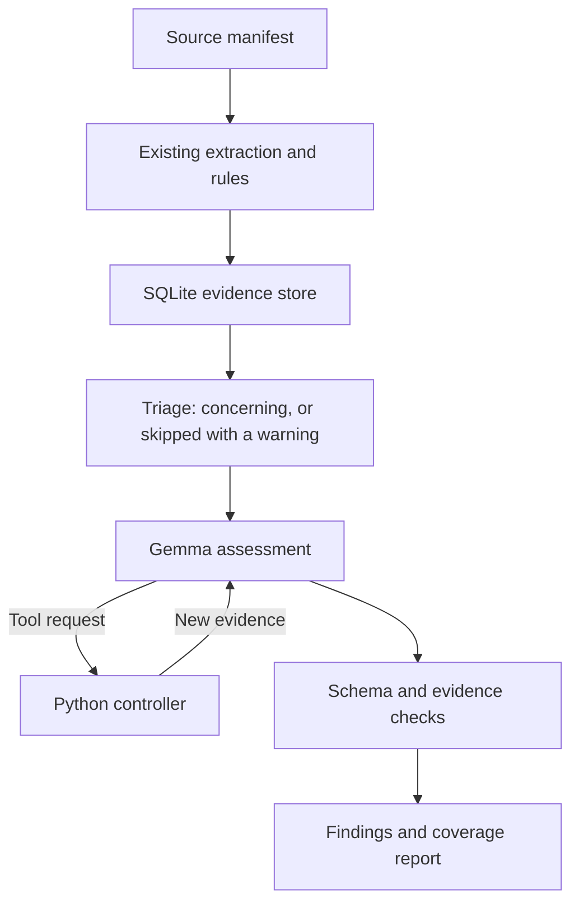

# Drawing Verification AI — Supervisor Edition

Experimental version: **0.2.0**. Branch: **supervisor-edition**.

This edition starts from `1255b86e444c20a3da390d368cb63708ea6ad17d`.
It preserves the source code in `sheetreader/`, `drawing-audit/`, `dimcheck/`, and `coherence/`.
It adds a separate `supervisor` package. Do not merge this edition into `main` as an update to the standard edition.

## Validation status

- The original deterministic suite passes in the build environment.
- Supervisor tests use synthetic drawings, scripted model responses, and a local HTTP test server.
- The build environment has no running Gemma model. Model accuracy, tool selection, thinking cost, and vision quality need local validation.
- `doctor --smoke` checks runtime compatibility. It does not certify engineering accuracy.
- Private real-sample tests require your local `DVA_SAMPLES_DIR` and expected data.

## Install separately on Windows

Open PowerShell. Use a new folder and environment:

```powershell
git clone --branch supervisor-edition --single-branch https://github.com/Christinantony/drawing-verification-ai.git drawing-verification-supervisor
cd drawing-verification-supervisor
python -m venv .venv
.venv\Scripts\Activate.ps1
python -m pip install -r requirements.txt pytest
ollama pull gemma4:e4b
python -m supervisor doctor --smoke
```

Use Python 3.10 or newer. Install Tesseract for scans and stroke-only PDFs.
For legacy `.doc` files, install LibreOffice, or use Microsoft Word and pywin32 on Windows.
Run `ollama serve` if Ollama is not already running.
The exact `gemma4:e4b` model must be installed. Another `gemma4` variant does not satisfy the check.
The model digest and Ollama version are recorded for each review.

## Check what will be reviewed first

```powershell
python -m supervisor plan "C:\Drawings\Set-A" --output "C:\DrawingReviews\Supervisor"
```

`plan` reads every file and runs every rule, then stops before Gemma. It prints and saves (`plans/<run>.md`):

- every file found, and whether it was read, unreadable, or not supported;
- which sections will go to Gemma, and why each one is concerning;
- which sections are skipped as not concerning, and why;
- every warning.

No model is used, so this takes only the reading time (seconds per text-layer PDF, under a minute per OCR sheet).

### Checklists are completed, not only checked

For each checklist matched to a drawing, the supervisor writes `runs/<run>/checklists/<name>_completed.docx`:

- Only **empty tolerance cells** are filled, with the value read from the drawing. No rows or dimensions are added.
- Existing values are never changed. A value that disagrees with the drawing is a high finding, and the cell keeps its value.
- Inserted cells are shaded **yellow** when read from the drawing at high confidence (printed tolerance or general table).
  They are shaded **orange** when the value is an assumed general tolerance or the dimension was found only near its zone; an engineer must confirm these.
- A cell whose drawing value cannot be read stays empty. The checklist is reported as not complete, with the cells listed.
- The source checklist is never written. A legacy `.doc` produces a `.docx` copy.
- No copy is written when the checklist has no empty cells.

The report has a **Checklists** table (rows, matched, inserted, to confirm, mismatch, still empty, complete) and the console prints one line per checklist.
On a real 20-row checklist with all tolerances removed, all 20 inserted values equalled the values entered by QC.

### What is reviewed and what is skipped

The decision is made by fixed, tested rules from the content that was read (`supervisor/triage.py`), not by Gemma. A Gemma call costs minutes on a CPU, and a decision made by fixed rules can be repeated and audited.

| Content | Sent to Gemma when | Otherwise |
|---|---|---|
| Drawing sheet | A medium/high rule finding, a required title-block field not read, words not in the dictionary, or low-confidence OCR words | Skipped, warning "all rules passed …" |
| Dimension checklist | A row disagrees with the drawing or could not be compared | Skipped, warning "every row matches the drawing or was filled from it" |
| Checklist with no matching drawing | — | Skipped, warning `checklist_without_drawing` |
| Link between two drawings | A cross-file rule raised a finding on that pair | Skipped, warning |
| Other Word/Excel document | It names a drawing number in this set | Skipped, warning "does not name any drawing number in this set" |
| Unsupported file (`.dwg`, `.step`, `.csv`, …) | — | Not read, warning `unsupported_file` with the reason |

Other warnings (they do not make a review incomplete):

- `reference_not_in_set`: a BOM line or `NEXT ASSY.` points to a drawing that is not in the folder.
- `checklist_cell_empty`: the checklist cell is empty; the warning gives the drawing value.
- `tolerance_assumed`: no tolerance is printed beside the dimension, so the general tolerance is assumed.
- `excel_formulas`: the saved values were reviewed, not recalculated.

**Incomplete** is now reserved for a planned check that could not run: an unreadable file, a checklist row that could not be compared, a checklist that matches several drawings, a model or tool failure, or a file changed during the review.

Use `--all` with `plan` or `review` to send every section to Gemma, as in v0.1.0.

## Review a drawing set

```powershell
python -m supervisor review "C:\Drawings\Set-A" --output "C:\DrawingReviews\Supervisor"
```

The command discovers supported files recursively. It handles PDF and image drawings, Word checklists, and generic Word/Excel text.
It excludes hidden directories, environments, the selected output folder, `reports`, and `supervisor-output`.
Symlinks are not reviewed. Keep input documents outside excluded folders.
Original files remain read-only. A checklist verification uses no output filename, so it does not write filled values back to the source.

Outputs:

```text
Supervisor/
  evidence.sqlite3
  latest.json
  runs/<unique-run-id>/
    report.md
    report.json
    evidence.json
    crops/                 # Only for requested source images
```

Each report has separate **issue status** and **coverage** fields.
Missing evidence, unreadable input, unavailable Gemma, invalid model output, or failed tool actions keep coverage incomplete.
Model findings never delete baseline findings. Official approval remains an engineer action.

Exit codes: `0` = complete/no issue; `1` = complete/issues found; `2` = incomplete; `3` = setup or fatal error.
Warnings never change the exit code. Read them: a skipped link check is not a passed link check.
Treat exit code 2 as a usable partial report, never as a clean review.

## Baseline comparison

```powershell
python -m supervisor review "C:\Drawings\Set-A" --output "C:\DrawingReviews\Baseline" --no-model
python -m supervisor review "C:\Drawings\Set-A" --output "C:\DrawingReviews\Supervisor"
```

Baseline-only runs intentionally have incomplete supervisor coverage.
The standard tools also remain available through their original commands.

## Control flow



1. Hash all input files and record the reader, controller, and dependency versions.
2. Run the existing readers. Cache their results by content, filename, code, and runtime versions.
3. Retain structured records, complete extracted text, raw word coordinates, and available OCR confidence.
4. Run the original drawing rules, known spelling rules, cross-drawing checks, and checklist verification.
5. Pack source sections into small review groups. Every source section receives an explicit coverage ID.
   Triage then keeps only concerning groups for Gemma; every skipped group gets a warning with its reason.
6. Give Gemma the evidence and a small typed tool catalogue.
7. Execute validated requests. Keep new readings separate from the originals.
8. Require a final structured assessment with exact source quotes and coverage IDs.
9. Join grounded generic-document part records to drawing records. Review the resulting relationship packets with Gemma.
10. Build reports with Python. Preserve incomplete checks and recheck source hashes.

The adapter observes the normal reader's loader return under a process-local lock. It restores the hook in `finally`.
It does not change the extraction algorithms or perform a second OCR pass just to retain coordinates.
The CLI processes one review at a time. CPU extraction is serial in this first edition.

## Available supervisor tools

| Tool | Result |
|---|---|
| `get_evidence` | Exact text and provenance for one evidence section |
| `get_source_layout` | Paginated word positions in original page coordinates |
| `get_related_records` | Paginated IDs for linked drawings, sections, and checklists |
| `search_evidence` | Local exact text search across reviewed documents |
| `run_check` | Existing drawing checks or stored baseline comparisons |
| `repeat_read` | Existing reader with normal or forced OCR; original result retained |
| `get_source_crop` | Original displayed PDF region or original image pixels |
| `lookup_requirement` | Local search over supplied approved requirements |
| `calculate` | Scaled length, tolerance limits, or length conversion to mm |

The model sends typed JSON requests. The controller does not execute model-generated Python or shell commands.
This uses one explicit JSON protocol over Ollama `/api/chat`, not an unbounded agent framework.
`run_check` has an allowlist. Tool arguments and evidence references are validated.
Document text cannot modify the tool catalogue or review policy.
Tool indexes disclose counts and the next offset. Larger tool results disclose every remaining section ID.

## Vision

```powershell
python -m supervisor doctor --smoke --vision
python -m supervisor review "C:\Drawings\Set-A" --vision
```

Enable vision only after the local smoke check succeeds. `--vision` requires an advertised model vision capability.
Gemma can look up source coordinates before requesting a crop. Crops use the original image, not the OCR line-erased raster.
PDF boxes use the displayed source page in points, including PDF page rotation. Image boxes use original pixels.
The adapter maps the reader's extra upright rotation back to source coordinates.
Images provide supplementary observations. Agreement between OCR and Gemma does not prove a value.
Full geometry and GD&T verification are outside this edition's demonstrated scope.

## Approved requirements

Use an explicit JSON file with this schema:

```json
[
  {
    "id": "YOUR-REQUIREMENT-ID",
    "source": "Your approved instruction title",
    "revision": "Your approved revision",
    "text": "Exact approved instruction text."
  }
]
```

```powershell
python -m supervisor review "C:\Drawings\Set-A" --requirements "C:\References\approved-requirements.json"
```

The file is supplied by the engineer. The program does not certify that its text is approved.
Requirement IDs, source titles and revisions travel with the evidence.
No standard, tolerance limit or acceptance value is taken from model memory alone.

## Budgets and reuse

Default settings:

- One resident local model; one sequential inference queue.
- A 16,384-token requested context, with a conservative text-byte budget and image reserve.
- A maximum of 1,000 generated tokens per turn. A truncated answer is a failed assessment.
- One initial assessment and at most two tool rounds per group.
- A 180-second investigation budget per group, including model calls and repeat-read tools.
- Thinking off for the first assessment; thinking on after a tool round.
- Vendor sampling defaults initially; engineering accuracy must determine later tuning.

```powershell
python -m supervisor review "C:\Drawings\Set-A" --thinking on --max-tokens 2000 --seconds 300
python -m supervisor review "C:\Drawings\Set-A" --reuse
```

`--thinking off` disables thinking in every turn. `--rounds 0` permits only the initial assessment.
Use `--context` to change the requested context. The byte budget deliberately stops a run rather than allowing silent truncation.
Large documents can need several groups. A budget failure appears as incomplete coverage.
The investigation budget is checked between actions; cheap local operations can add small overhead.
Initial extraction is outside this per-group budget. Repeat OCR runs in a terminable process.

The extraction cache is automatic. `--reuse` enables reuse of compatible completed assessments that used no tools.
The model cache includes the whole input manifest, requirements, code version, model digest, runtime, prompt package, and settings.
A change anywhere in the set invalidates model assessments. This conservative policy prevents stale cross-file conclusions.
Fine-grained dependency cache invalidation and parallel extraction are deferred until runtime measurements justify them.
Tool-assisted assessments run again. Previous thinking traces never enter later prompts.

## Local acceptance procedure

1. Run `python -m pytest -q`.
2. Run the text/thinking/protocol smoke checks against your installed model.
3. Select held-out drawings that were not used to tune extraction.
4. Include clean drawings, planted errors, missing children, poor OCR, and valid exceptions to apparent rule errors.
5. Run baseline-only and supervisor reviews on the same set. Keep all outputs.
6. Have an engineer label true findings, false findings, missed errors, and correct unresolved decisions.
7. Compare review time, model token counts, and peak machine memory.
8. Enable vision, then repeat the ambiguous-symbol and rotated-page cases.
9. Record the exact model digest and runtime before changing settings.

No test result in this repository establishes Gemma accuracy on confidential company drawings.
The first release remains experimental until these checks pass.
