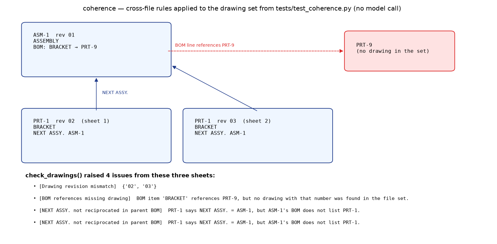

# Document coherence checker

Scans a folder of drawing PDFs, Word documents and Excel workbooks for one
product, uses a local Gemma model through Ollama to extract structured
records, then applies deterministic rules to find inconsistencies **between**
files.

## What it checks

**Across drawing PDFs** (title block and BOM extracted per sheet):

- The same drawing number on several sheets with different revision, date or title.
- A BOM line that references a drawing number missing from the file set.
- A BOM description that disagrees with the referenced drawing's title.
- `NEXT ASSY.` links that do not point to a known drawing, or are not
  reciprocated in the parent assembly's BOM.

**Across Word and Excel files:**

- The same part number appearing with different names, revisions or dates.
- An optional fuzzy pass that asks the model whether differently named,
  unnumbered parts are the same part, reported for manual verification.

The model only extracts fields; every pass/fail decision is made by the
rules in `check_drawings()` and `find_generic_mismatches()`, which are covered
by `../tests/test_coherence.py`.



*The drawing set from `../tests/test_coherence.py`, run through the real rules
(`python ../tests/make_figures.py`). No model is involved in this step.*

## Usage

```bash
pip install python-docx openpyxl requests pdfplumber
ollama pull gemma3:4b

python check_coherence.py path/to/folder --out coherence_report.md
python check_coherence.py path/to/folder --model gemma4:e4b --skip-fuzzy
```

The default model is `gemma3:4b`, which was used when this script was
written; any Ollama model tag can be passed with `--model`.

## Limitations

- PDF text is read with pdfplumber only. Scanned or rotated sheets with no
  usable text are listed under "Pages needing OCR / rotation" and skipped;
  the OCR and orientation handling lives in `../drawing-audit/`.
- Extraction quality depends on the model reading jumbled PDF text
  correctly; a wrong extraction can cause a false finding.
