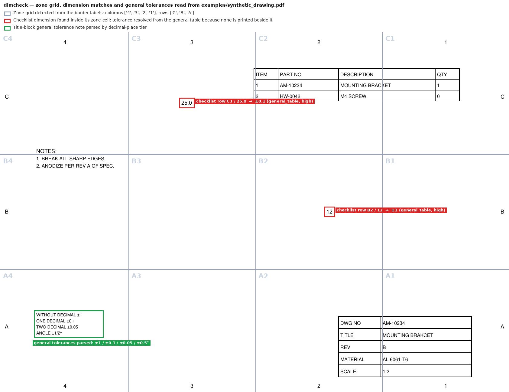
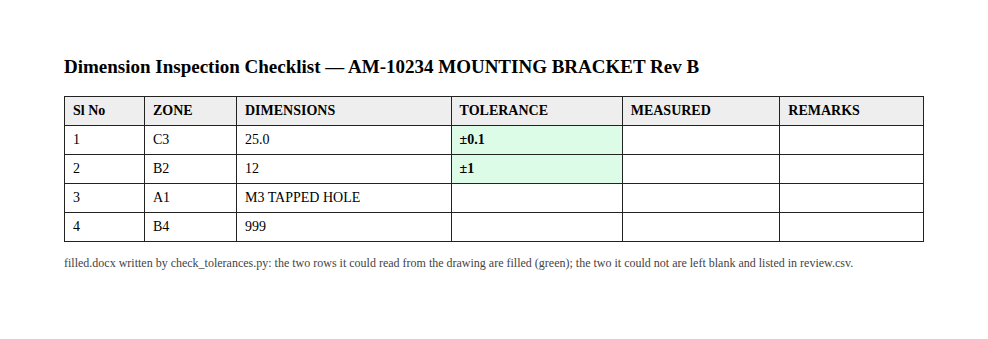

# dimcheck — drawing tolerance → checklist filler

> **Repository status:** all modules — `pdf_layout.py`, `zoning.py`,
> `general_tolerance.py`, `dimension_matcher.py`, `checklist_io.py` and
> `pipeline.py` — are present, and `check_tolerances.py` runs end to end.
> Every stage is covered by tests in `../tests/test_dimcheck.py`, including
> `dimension_matcher.py`'s zone-cell matching and the full PDF-to-filled-DOCX
> pipeline, run against the synthetic drawing. The six-of-six result
> described below comes from the original development run against a real
> drawing/checklist pair, not from this repository's tests.

Reads tolerances off an engineering drawing PDF (zoned per ISO-7200-style
border grids, e.g. "F6", "C5") and fills them into the Tolerance column of a
dimension checklist DOCX, using each row's Zone + nominal Dimension to find
the matching text on the drawing.

Built and validated against a real Verdant Telemetry drawing + checklist
pair — with the checklist's known-correct tolerances blanked out, the tool
reproduces all six values exactly from the drawing alone.

On the published synthetic drawing (`../examples/synthetic_drawing.pdf`),
run end to end against a four-row checklist:






The thread callout in zone A1 and the dimension `999` are not on the sheet,
so their cells stay empty and the CSV says why. `python ../tests/make_figures.py`
regenerates the overlay.

**Known open issue:** asymmetric/unilateral limits (e.g. an upper limit with
a zero lower limit, or vice versa, typically drawn as two stacked figures
rather than a single `±` value) are not parsed correctly yet — the matcher
falls through to the general-tolerance table instead of reading the actual
printed limits. A fix (reading stacked limit figures above/below the
dimension, including a bare `0` for one side) was in progress.

**Planned:** route low-confidence/ambiguous matches (zone-boundary misses,
thread/feature callouts, fit codes) through a locally-run Gemma 4 E4B model
for a second-pass reasoning check instead of just flagging them, so fewer
rows need manual review.

## How it works

1. **Read the drawing** (`pdf_layout.py`) — extracts every word and its
   position. Uses the PDF's native text layer when present; falls back to
   OCR (`tesseract` on a rasterized page) automatically when it isn't —
   pass `--force-ocr` to force this for a drawing with a thin/unreliable
   text layer.
2. **Detect the zone grid** (`zoning.py`) — finds the column numbers along
   the top/bottom margins and row letters along the left/right margins, and
   builds cell boundaries from their positions. This is a spatial heuristic,
   not a fixed template, so it should generalize to other drawings using the
   same lettered/numbered border convention (assumes `<letter><number>`
   zone codes, e.g. "F6" — pass a different convention by adjusting
   `zoning.ZoneGrid` if a drawing uses `<number><letter>` instead).
3. **Parse the general tolerance table** (`general_tolerance.py`) — the
   title-block note like "WITHOUT DECIMAL ±1 / ONE DECIMAL ±0.1 / TWO
   DECIMAL ±0.05 / ANGLE ±½°", used whenever a dimension has no tolerance
   of its own.
4. **Match each checklist row's dimension in its zone**
   (`dimension_matcher.py`) — handles a few real wrinkles found even in the
   one sample drawing:
   - **rotated text**: dimension text rotated 180° can come back with
     characters reversed ("8.5" → "5.8"); both orderings are checked.
   - **multi-token dimensions**: e.g. "1.0" + "THRU" on the same line.
   - **thread/feature callouts** ("M3", "M3 TAPPED HOLE") aren't plain
     numbers, so they can't be matched to a decimal-place tier — the tool
     flags these as an *assumption* rather than a fact.
   - **explicit per-dimension tolerances** (± value, dual-limit `+x/-y`,
     or a fit code like `H7`/`js6`) next to a dimension override the
     general table. Fit codes are flagged for manual conversion rather than
     guessed, since the numeric value depends on the nominal size range
     (ISO 286 or equivalent).
   - **asymmetric/unilateral limits** (e.g. `+0.10` over `0`, or `0` over
     `-0.05`, usually drawn as two stacked figures rather than one `±`
     value) — **currently a known bug**: see "Known open issue" above.
   - **zone-boundary imprecision**: the grid is derived from label
     positions, not the true printed tick marks, and a dimension's *text*
     doesn't always sit exactly inside the cell its *leader line* points
     into. If nothing matches in the exact cell, the search widens and the
     result is marked lower confidence rather than silently accepted.
5. **Write the checklist** (`checklist_io.py`) — finds the data table by
   content (looking for a column of zone-code-shaped cells), not by
   assuming a fixed table index, since in the sample template the header
   row itself lives in the page header/footer (repeated per printed page)
   rather than in the table.

## Usage

```bash
pip install pdfplumber python-docx pytesseract pillow --break-system-packages
# tesseract and poppler-utils (pdftoppm) must be installed system packages

python check_tolerances.py DRAWING.pdf CHECKLIST.docx -o FILLED.docx --report review.csv
```

Options (see `python check_tolerances.py -h`):
- `--page N` — which PDF page to read (0-indexed)
- `--zone-col / --dim-col / --tol-col` — checklist column indices, if your
  template differs from the default layout `[Sl No, Zone, Dimension,
  Tolerance, ...]`
- `--overwrite` — replace tolerance cells that already have a value
  (default: leave them alone and just report them)
- `--force-ocr`, `--ocr-dpi` — OCR controls for scanned drawings

An example of the per-row review report is in
[`example_output/review_report_demo.csv`](example_output/review_report_demo.csv).

## What still needs a human

The tool is intentionally conservative: anything it can't resolve with
confidence is left blank in the output and called out in the console
report / CSV, rather than guessed silently. In practice this means:

- **Asymmetric/unilateral limits** — not read correctly yet (see above);
  double-check any row whose drawing uses this style until the fix lands.
- **Fit/limit codes** (H7, js6, ...) — numeric value not looked up.
- **Thread/feature callouts** with no explicit tolerance nearby — filled
  with the general table's one-decimal tier as a labeled *assumption*,
  flagged for confirmation.
- **Medium/low confidence matches** — the dimension text was found outside
  its expected zone cell; still filled in, but worth a spot-check.
- **Legacy `.doc` checklists** — convert to `.docx` first, e.g.:
  `soffice --headless --convert-to docx CHECKLIST.doc`

## Files

```
dimcheck/
  pdf_layout.py          PDF text/OCR extraction -> tokens with bounding boxes
  zoning.py               Border-grid detection, zone <-> (x,y) mapping
  general_tolerance.py    Title-block general tolerance table parser
  dimension_matcher.py    Locate a checklist dimension on the drawing, find its tolerance
  checklist_io.py         Read/write the checklist DOCX table
  pipeline.py             Orchestrates the above, produces a review report
check_tolerances.py       CLI entry point
```

## Extending to a batch of drawings

For a folder of drawing/checklist pairs, loop `pipeline.process(...)` per
pair (matching filenames by part number is usually enough, e.g. this
sample's `VT-JH_40_A1-E-08...pdf` / `VT-F-DCL-JH_40_A1-E-08...docx`), and
concatenate the CSV reports for a single review pass across the batch.
