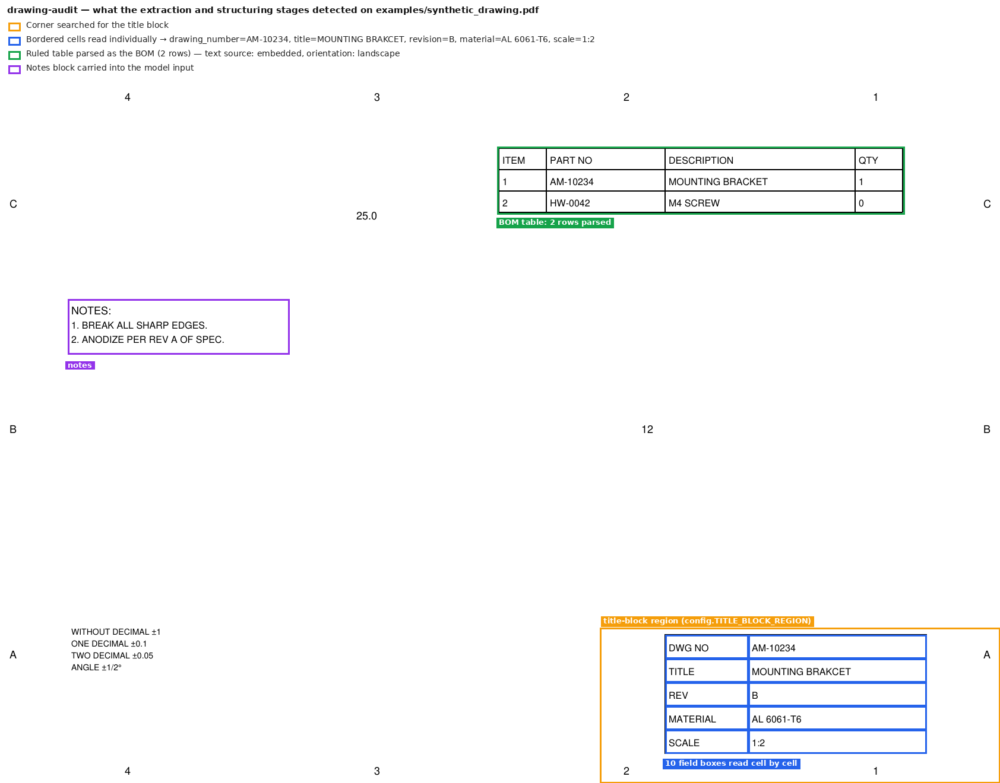

# Offline 2D Drawing Verification Checker

Audits engineering drawings (PDF or scanned image) for **spelling/grammar
errors**, **internal contradictions**, and **BOM-to-title-block mismatches**
- entirely offline, using **Gemma 4 E4B** running locally through **Ollama**.

## Why text-first, not "just show it the image"

Gemma 4 E4B can accept images, but small vision-language models are
unreliable at precisely reading dense, small text laid out in a crowded
title block or table - exactly the layout of a real drawing. So this tool
never asks the model to *look* at the drawing. Instead:

1. **Extraction** (`extraction.py`) - PyMuPDF pulls embedded text directly
   out of vector PDFs (exact, no OCR errors), including the title-block
   corner specifically via a clipped text query - pdfplumber pulls any
   ruled table (usually the BOM). **OCR only ever runs as a fallback**,
   when a page has no extractable text at all (a scanned PDF page or a
   plain image). This applies to the title-block crop too, not just the
   full page - a vector PDF never gets OCR'd, even for the focused
   title-block pass.
   Scanned pages/images also get an orientation check before anything
   else: Tesseract's orientation-and-script detection (OSD) catches a page
   fed in sideways or upside down and rotates it upright first, since a
   sideways page both OCRs badly and gets its title block cropped from the
   wrong corner. Vector PDFs don't need this - PyMuPDF already applies a
   page's declared rotation automatically, and every region crop is
   computed as a fraction of the page's actual (corrected) width/height,
   so landscape and portrait sheets are both handled without
   special-casing.
2. **Cell isolation** (also `extraction.py`) - many title blocks draw each
   item (DWG NO, TITLE, REV, MATERIAL, ...) inside its own bordered
   rectangle rather than as one blob of text. Rather than OCR/regex over
   the whole corner and hope labels and values land on the same line, the
   pipeline finds each individual box and reads only what's inside it:
   - **Vector PDFs** - reads the page's actual vector drawing objects (the
     CAD software's rectangle entities) and pulls the embedded text under
     each one directly. Still zero OCR.
   - **Scanned pages/images** - finds the grid's ruling lines with OpenCV
     (morphological line detection + contours), then OCRs each enclosed
     cell individually - a small, clean, single-cell crop OCRs far more
     reliably than the whole corner at once.
   Each cell's text is then matched against known field labels
   (`classify_title_block_cells` in `structuring.py`), handling both a
   label+value written in the same box ("DWG NO: AM-10234") and a
   label-only box paired with an adjacent value-only box (checks
   right-neighbor, then below-neighbor). Any field a cell pass doesn't
   capture is backfilled by the regex-over-text-blob pass, so a template
   that isn't drawn as ruled boxes at all still works the old way.
3. **Structuring** (`structuring.py`) - the cell/regex results above are
   assembled into a canonical `title_block` dict and a normalized `bom`
   list, rendered as clean Markdown.
4. **Auditing** (`audit.py`) - that Markdown (not the image) is handed to
   Gemma 4 E4B with its native **`<|think|>` reasoning mode** turned on, and
   the model cross-examines it and returns structured JSON findings.

Nothing leaves your machine at any point, and no internet connection is
required once setup is complete.

What steps 1 to 3 detect on the synthetic drawing in `../examples/`, drawn
over the sheet (`python ../tests/make_figures.py`):



The text handed to the model for this sheet is in
[`../examples/synthetic_structured_input.md`](../examples/synthetic_structured_input.md).

---

## 1. Prerequisites (Windows 10)

| Tool | Why | Get it |
|---|---|---|
| Python 3.10+ | Runs the pipeline | [python.org/downloads](https://www.python.org/downloads/) - check **"Add python.exe to PATH"** during install |
| Ollama | Serves Gemma 4 E4B locally | [ollama.com/download](https://ollama.com/download) (Windows installer) |
| Tesseract OCR | OCR fallback for scans/images | [UB-Mannheim build](https://github.com/UB-Mannheim/tesseract/wiki) - run the `.exe` installer |

You do **not** need Poppler/GhostScript - PyMuPDF renders PDF pages to
images internally, so there's nothing extra to install for PDFs.

## 2. Setup

Open **PowerShell** in this project folder:

```powershell
# 1. Create and activate a virtual environment
python -m venv venv
venv\Scripts\activate

# 2. Install Python dependencies
pip install -r requirements.txt

# 3. Pull the model (~9.6 GB download, one-time, needs internet)
ollama pull gemma4:e4b
```

If Tesseract wasn't added to your PATH by its installer, open `config.py`
and set:

```python
TESSERACT_CMD = r"C:\Program Files\Tesseract-OCR\tesseract.exe"
```

**Hardware note:** E4B is Google's ~4.5B-effective-parameter "edge" model
(9.6 GB on disk, Q4 quantized) - it runs on a modern laptop, but CPU-only
inference with thinking mode enabled will be noticeably slower than a GPU
with 6+ GB VRAM. The first run after `ollama pull` will also be slower
while the model loads into memory.

## 3. Usage

```powershell
# Basic - writes reports\<filename>_report.md
python main.py path\to\drawing.pdf

# Choose the output path, and also dump the raw structured+audit JSON
python main.py path\to\drawing.pdf -o reports\job123.md --json

# Works on scanned images too
python main.py path\to\scan.png

# Disable thinking mode for a faster, shallower pass
python main.py path\to\drawing.pdf --no-thinking
```

The generated Markdown report contains:
- Per-page orientation and any rotation correction applied
- How the title block was read (N bordered field boxes detected and
  cell-classified, vs. regex-over-text-blob only)
- The extracted title block (as a table)
- The extracted, normalized BOM (as a table)
- A findings list (severity, category, location, description, suggested fix)
- A one-paragraph summary
- The model's reasoning trace, in a collapsible section, for auditability

## 4. Tuning for your drawing template

Real title blocks and BOMs vary a lot between companies and CAD tools.
Everything you'll likely need to adjust lives in `config.py`:

- `TITLE_BLOCK_REGION` - which corner of the sheet gets a focused OCR pass
  (default: bottom-right 40% width x 22% height).
- `TITLE_BLOCK_FIELDS` - regex label variants per field (add your own
  aliases, e.g. if your template uses "DWG #" instead of "DWG NO").
- `USE_TITLE_BLOCK_CELLS` - set to `False` to disable per-box cell
  isolation entirely and always use regex-over-text-blob (useful if your
  template genuinely has no bordered boxes and you want to skip the
  detection pass).
- `MIN_CELL_AREA_FRAC` / `MAX_CELL_AREA_FRAC` - size filters (as a fraction
  of the title-block region's area) for what counts as a plausible cell vs.
  noise or the outer frame. Widen these if real cells are being rejected or
  stray marks are being picked up as cells.
- `BOM_HEADER_ALIASES` - column header variants used to detect and map BOM
  table columns.

## 5. Troubleshooting

- **"Could not find model 'gemma4:e4b'"** - run `ollama pull gemma4:e4b`
  and confirm Ollama is running (`ollama list` should show it).
- **Garbled OCR text / poor title-block extraction** - scanned drawings at
  low resolution OCR poorly. Try re-scanning at 300+ DPI, or narrow/widen
  `TITLE_BLOCK_REGION` in `config.py` to better frame your template's
  title block.
- **A field is found but paired with the wrong neighboring box** - the
  cell-adjacency matching (label box -> nearest value box) can mispair on
  unusual layouts. Check the report's "Title block extraction" line for the
  detected cell count, and the raw structured JSON (`--json`) for cell
  bounding boxes if you need to debug placement.
- **No BOM rows detected** - if your BOM isn't a ruled table (pdfplumber
  finds nothing) and the text-based fallback also can't find 2+ recognizable
  headers, add your column names to `BOM_HEADER_ALIASES`.
- **Slow first response** - normal; Ollama loads the model into memory on
  first use per session and keeps it warm afterward.

## 6. Limitations

This is a heuristic pipeline, not a certified inspection tool: regex-based
field/table extraction can miss unusual layouts, OCR can misread poor-quality
scans, and Gemma 4 E4B (a small on-device model) can still miss subtle
errors or occasionally flag a false positive. Treat findings as a fast first
pass that narrows down what a human reviewer should double-check - not a
substitute for engineering sign-off.

## Project layout

```
config.py           tunable settings (model name, regex patterns, OCR options)
extraction.py        PDF/image -> raw text, tables, page images
structuring.py       raw text/tables -> canonical title_block + bom JSON/Markdown
ollama_client.py      Ollama chat wrapper, native <|think|> handling, JSON parsing
audit.py             the audit prompt + orchestration of the Gemma 4 call
main.py               CLI entry point
requirements.txt
```
